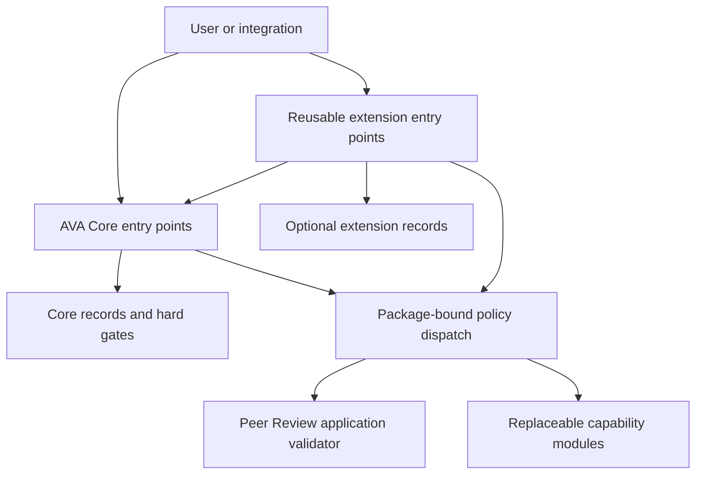

# AVA Technical Architecture

This document describes the public technical architecture of the AVA Solidity
demo. The project is an early sample of the AVA protocol with peer review as
its first application. Peer review is the only application implementation in
`src/apps/`. A domain-neutral test fixture demonstrates that the same Core can
isolate another application without shipping a second domain implementation.
It is not a full journal platform, a
manuscript decision engine, a scientific-truth engine, a disclosure-reveal
system, a payment system, or a sanction engine.

The demo shows how peer-review governance can be represented as role-scoped
subjects, evidence-backed records, authorised transitions, rule packages,
privacy-preserving proof receipts, and bounded downstream records.

The implementation is written as a Base-compatible EVM/Solidity contract demo.
Base is the intended L2 target for future deployment work. The current
repository remains a local Foundry demo. It does not include deployed Base
addresses, production deployment hardening, chain-specific governance rollout,
or live network configuration.

## 1. Architecture Boundary

AVA is represented through three macro stages:

- Attribution: who acts, under which role-scoped subject, and with what
  authority.
- Verification: which evidence-backed governance object becomes a recognised
  state, and how it can be challenged, corrected, restored, or vested.
- Allocation: which bounded downstream record may follow from an eligible
  recognised state.

Recognised state is the central governance object. It is not a fourth AVA
stage. Challenge, correction, restoration, disclosure, standing, reward,
priority, penalty, value settlement, and credentials are support or downstream
surfaces around recognised states; they are not additional AVA stages.

The contracts do not decide manuscript acceptance, rejection, manuscript merit,
scientific truth, reviewer leniency, or publication priority.

## Canonical Source Boundary

The implemented architecture has three source-level ownership boundaries:

| Layer | Canonical location | Owns |
| --- | --- | --- |
| AVA Core | `src/core/` | application namespace, canonical subjects, authority, package identity, evidence and disclosure-policy references, governed objects, recognised states, and the generic transition ledger |
| Reusable extensions | `src/extensions/` | optional challenge, standing, credential, privacy-proof, disclosure, audit, settlement, consequence, and external-operation records |
| Applications | `src/apps/peerreview/` | app ids, role/action/object vocabulary, relationship rules, and validator-only application modules |

Core imports no application source. Users call Core or an extension directly;
an application module validates context through `STATICCALL` semantics and
cannot own or mutate Core storage. `PeerReviewApplicationModule` therefore
remains a replaceable package component, not a privileged forwarding contract.

The canonical production manifest also imports the domain-neutral
`src/AVAApplicationRegistry.sol` and the shared `IAVAApplicationModule`,
`IRuleModuleIdentity`, and `IZKProofVerifier` interfaces from `src/interfaces/`.
Their current physical location is an explicit layout exception; they belong
to the canonical surface, not the retained Peer Review implementation.



The arrows from package dispatch to application and capability modules are
validation or veto calls. They do not transfer storage ownership, mutation
authority, or caller identity to those modules.

Apart from the canonical exceptions named above, the repository retains the
earlier root-level implementation under `src/` so its larger research
scenarios and regression suite remain reproducible. New applications should
use the canonical Core, extension, and app surfaces. The retained stack is not
a second recommended substrate.

## 2. From Governance Grammar To Records

The research-facing AVA grammar asks what has become governable before a
technical system records or executes anything. The Solidity demo translates
that grammar into a small set of chain-readable objects:

| Governance question | Contract representation |
| --- | --- |
| What object is being attributed? | Manuscript pointer, review contribution, recognised-state object id, challenge target, or external-operation target. |
| Who is responsible or authorised? | Role-scoped `subjectId`, `authorityId`, role/action permission, and caller binding. |
| What evidence was received? | Evidence receipt id, commitment, URI, evidence type hash, workflow key, package id, and lifecycle status. |
| What disclosure condition applies? | Disclosure policy id, disclosure module validation, proof-use receipt, access/lifecycle receipt, subject commitment, and nullifier where relevant. |
| What governance state exists? | `RecognisedStateRecord` plus generic recognised-state transition ledger. |
| How can it be challenged or repaired? | Challenge record, challenge transition record, outcome, correction/restoration path, and preserved history. |
| What bounded downstream record can follow? | Standing input, standing computation, credential, allocation, consequence, penalty, restoration, settlement, external-operation, or audit record, all tied to an eligible source. |

This is the rule-to-executable bridge. A prose institutional rule must be
translated into an object, subject, evidence receipt, authority condition,
disclosure condition, recognised state, transition condition, and bounded
consequence before it can become a module check or substrate record.

The bridge also defines the model boundary. These records can later support
modelling as states, actions, transitions, information conditions, and payoff
proxies. The Solidity demo itself does not run a model, simulation,
probability estimate, truth engine, or manuscript-merit calculation.

For paper-facing verification, the repository includes a hash-pinned
recognised-state transition matrix and named boundary-claim tests. Matrix rows
are checked against row-level kernel execution, and the boundary tests tie the
no-publication, no-truth, no-reveal, no-sanction-execution, no-standing-token,
raw-id, and high-impact-status boundaries to executable artifacts.

## 3. System Layers

The canonical implementation has three practical ownership layers and one
package-dispatch layer.

### Domain-Neutral Core

Core owns only invariants shared by applications. Its principal contracts are:

- `AVAApplicationRegistry`
- `AVAIdentityRegistry`
- `AVAAuthorityMatrix`
- `AVACoreRulePackageRegistry`
- `AVADisclosurePolicyRegistry`
- `AVAEvidenceRegistry`
- `AVAGovernanceKernel`

`AVAGovernanceKernel` stores generic governed objects, recognised states, and
every recognised-state transition. It has no application-specific role or
object vocabulary.

### Reusable Extension Layer

Extensions depend on Core; Core does not depend on them. The current extension
families cover challenge/correction/restoration, standing revision and
credentials, bounded standing/allocation/consequence records, privacy-proof
and disclosure receipts, audit receipts, settlement receipts, and external-
operation receipts. Missing optional capability bindings fail closed rather
than becoming permission.

### Application Layer

`PeerReviewApplicationModule` validates manuscript/review relationships and
peer-review roles. A domain-neutral `SecondaryTestApplicationModule` under
`test/helpers/` exercises different roles and object relationships against the
same Core. The fixture may reuse the same `workflowKey` while remaining
isolated by `appId`; it is not a production application.

### Historical Appendix: Retained Pre-Separation Reference Stack

The earlier root-level implementation remains compiled and tested through the
explicit `retained` Foundry profile for research continuity. It is excluded
from the default canonical production manifest. Its principal contracts
include:

- `RoleIdentityRegistry`
- `AuthorityMatrix`
- `EvidenceCommitmentRegistry`
- `DisclosurePolicyRegistry`
- `AVARulePackageRegistry`
- `RulePackageIdentityVerifier`
- `AVAWorkflowValidator`
- `AVAStateMachine`
- `AVAChallengeWorkflow`
- `StandingRevisionRegistry`
- `StandingRegistry`
- `AllocationExecutor`
- `ConsequenceExecutor`
- `AttestationAuditModule`

These contracts document the path by which the demo reached the canonical
separation. They should not be used to add a third application.

### Rule-Package Layer

Rule packages bind a `workflowKey` to validator modules and adapters. Each
registration creates a stable `packageId`. New records use the currently active
package for a workflow key, but old records keep the package identity recorded
when they were created.

Initial registration and supersession are separate calls. A workflow key cannot
be overwritten through `registerRulePackage`; `supersedeRulePackage` must name
the expected current package and provide a higher version. Each module exposes
`moduleIdentityHash()`. Registration stores three separate commitments:
`modulesHash` fixes the ordered capability-to-address layout,
`modulesIdentityHash` preserves the ordered capability-to-identity audit view,
and `modulesIdentityFingerprint` commits each unique module address and identity
once. Every package read recomputes the unique-module fingerprint across the
whole package and fails closed if any identity has changed. Proxy modules whose
behaviour cannot be stably revalidated are outside the supported package model.
Each canonical package may bind at most 64 capabilities. This keeps historical
module-identity revalidation bounded while leaving room for application-specific
extensions.
Canonical high-frequency registration and shared-extension paths resolve the
capabilities they need through one compact verified dispatch.
`getActiveVerifiedModulesCompact` combines the active-package check with full
package-identity verification for new intake, while
`getVerifiedModulesCompact` verifies a stored historical `packageId` and
returns only fixed-size package context plus the requested modules. Compact
governed-object, recognised-state, and transition readers omit dynamic or
unused provenance fields on hot contract-to-contract paths. Full package,
object, state, transition, and subject getters remain available for audit and
record reconstruction. This is not a cross-transaction cache: every new
operation recomputes and checks all unique module identities in the package.

Compatibility tooling sits outside the contracts. A generated ABI manifest
locks selectors, events, errors, constructors, mutability, and return shapes
for the canonical production surface. A deterministic local package-manifest
script reconstructs package metadata, capability bindings, and module identity
hashes from registry reads. A test-only application conformance helper checks
verified package context, application-module identity, historical package
pinning, and rejected cross-application calls. These tools detect integration
drift without adding storage, proxy logic, or runtime compatibility branches.

This prevents future workflow reconfiguration from retroactively changing old
recognised states, challenges, proof receipts, standing records, settlement
records, or downstream consequences.

This is the main extension pattern:

```text
AVA substrate -> functional interface -> scenario-selected module
```

For example, the substrate calls `IAttributionModule` when a workflow object is
formed. A default package may use `DefaultAttributionModule`; a pseudonymous
review package may use `SubjectSaltAttributionModule`. The caller still goes
through the same substrate entrypoint, authority check, subject binding,
evidence check, package binding, and record ledger.

The same pattern applies across the rest of the rule package:

- `IVerificationModule` can be backed by default reference validation or an
  evidence-threshold module.
- `IDisclosurePolicyModule` can be backed by double-blind, panel-visible,
  anonymous challenge, voluntary real-name, post-recognition author-reveal, or
  ZK-backed disclosure modules.
- `IChallengeLifecycleModule` can use the default lifecycle or a panel-only
  lifecycle rule.
- `IStandingAdapter`, `IStandingComputationModule`, and credential issuers can
  vary standing vectors and proof surfaces without turning standing into a
  token or public prestige score.
- `IRewardAdapter`, `IPriorityAdapter`, `IPenaltyAdapter`,
  `IRestorationAdapter`, and `IValueExecutionAdapter` can vary downstream
  record readiness while keeping actual records source-bound and bounded.

Modules validate or veto. They do not grant authority, mutate substrate storage
directly, reinterpret ids, reveal identity, execute sanctions, decide
publication, or judge scientific truth. The substrate writes records only after
the relevant substrate gates and module checks all pass.

Two example validator modules show how governance memory can later constrain
workflow use without becoming a punishment or reward engine.
`RestrictionAwareChallengeIntakeModule` reads active package-bound eligibility
restrictions and can veto later challenge intake by the restricted subject
until expiry; there is no early-lift path in the current demo.
`CredentialGatedPanelModule` reads active standing credentials for a panel
authority subject and can veto a configured panel action unless the active
credential index resolves to a usable package-, subject-, vector-, category-,
and threshold-matching credential. Both modules are validator-only and write no
records.

### Privacy And Proof Layer

Privacy-related contracts record proof-use and disclosure receipts. They bind
context, package identity, target object, subject or subject commitment,
policy, verifier, proof domain, and nullifier where relevant.

These contracts do not reveal identity, decrypt evidence, implement production
access control, or prove scientific truth.

Key contracts:

- `ZKProofRegistry`
- `DisclosureAccessExecutor`
- `StandingFormulaRegistry`
- `ZKStandingComputationRegistry`
- `ZKStandingCredentialRegistry`
- `StandingCredentialRegistry`

### Downstream Record And Execution Layer

Downstream contracts can record bounded consequences, allocation records,
standing update inputs, standing computation statements, standing credentials,
administrative-priority artifacts, mock settlement receipts, recovery records,
and external-operation intents.

These records are audit surfaces. They are not publication effects, real
payments, sanction execution, or reputation tokens.

Key contracts:

- `AllocationExecutor`
- `ConsequenceExecutor`
- `ValueSettlementExecutor`
- `ExternalOperationRegistry`
- `StandingRegistry`
- `StandingCredentialRegistry`

## 4. Contract Map

### Canonical Contracts

| Contract | Public role |
| --- | --- |
| `AVAApplicationRegistry` | Registers each immutable application namespace once. |
| `AVAIdentityRegistry` | Stores canonical active subjects by application, role, and account. |
| `AVAAuthorityMatrix` | Enforces application-scoped role/action permissions and authority-subject binding. |
| `AVACoreRulePackageRegistry` | Registers immutable capability bindings under `(appId, workflowKey)`, rejects missing or zero module identity, revalidates the aggregate identity, and advances explicit active-package pointers. |
| `AVAWorkflowPolicyRouter` | Resolves a state or challenge package once per top-level validation and dispatches package-bound verification, transition, evidence, disclosure, challenge, authority, field, and anti-abuse policy. It is stateless and cannot mutate Core. |
| `AVACoreTransitionRules` | Defines the nondelegable formation, generic-transition, vesting, challenge-target, correction, and restoration graph shared by the kernel, challenge extension, matrix generator, and tests. |
| `AVADisclosurePolicyRegistry` | Stores application-scoped disclosure-policy references without reveal or decryption. |
| `AVAEvidenceRegistry` | Stores application/workflow/package/subject-bound evidence commitments and lifecycle records. |
| `AVAGovernanceKernel` | Stores generic governed objects, recognised states, and transition records; enforces nondelegable status boundaries plus parent application/package compatibility. |
| `AVAChallengeExtension` | Stores challenge lifecycle records. Each challenge refers to a governed challenge object and its own recognised state/package; the extension may request only source-bound Core transitions permitted by the shared hard graph and target package policy. |
| `AVAStandingRecordExtension`, `AVAAllocationRecordExtension`, `AVAConsequenceRecordExtension` | Store separate bounded downstream records against eligible state versions. |
| `AVAStandingComputationExtension`, `AVAStandingCredentialExtension` | Record authorised standing outputs and non-transferable, expiring, revocable/supersedable proof carriers. |
| `AVAPrivacyProofExtension`, `AVADisclosureReceiptExtension` | Store context-bound proof and disclosure receipts without reveal, decryption, or production ACL. |
| `AVAAuditReceiptExtension` | Stores evidence-, state-version-, recognised-state-transition-, and challenge-transition-bound audit receipts. |
| `AVASettlementReceiptExtension`, `AVAExternalOperationExtension` | Store source-bound settlement and terminal external-operation receipts without transferring value or calling external platforms. Active external-operation requests and acknowledgements require current source lineage; cancellation and supersession can close an immutable historical request after later state, evidence, or package drift. |
| `PeerReviewApplicationModule` | Validates peer-review vocabulary and object relationships. Peer-review disclosure and penalty policy modules select scenario rules without owning Core storage. |

### Retained Pre-Separation Contracts

| Contract | Public role |
| --- | --- |
| `RoleIdentityRegistry` | Stores canonical role-scoped subjects and active/inactive subject state. |
| `AuthorityMatrix` | Stores role/action permissions and enforces authority-subject binding. |
| `EvidenceCommitmentRegistry` | Stores evidence receipts as commitments, URIs, workflow/type references, package identity, disclosure policy references, and lifecycle status. |
| `DisclosurePolicyRegistry` | Stores disclosure policy metadata and active policy references. |
| `AVARulePackageRegistry` | Registers immutable workflow packages, module/adaptor bindings, compatibility metadata, explicit supersession records, and active-package pointers. |
| `AVARulePackageLifecycleRegistry` | Records package lifecycle, object-migration readiness, and disclosure-lifecycle readiness against immutable package, state, evidence, and policy references. It does not migrate objects. |
| `RulePackageIdentityVerifier` | Aggregates the re-verifiable behaviour identities exposed by every rule-package module. |
| `AVAWorkflowValidator` | Runs package-bound attribution, verification, evidence, disclosure, field, lifecycle, and anti-abuse validation without owning workflow records; exposes the shared active, workflow/package-pinned evidence-reference check used by later transitions. |
| `AVAStateMachine` | Stores manuscripts, review contributions, recognised states with responsible subjects, review challenge-window counts, and generic recognised-state transitions. |
| `AVAChallengeWorkflow` | Stores challenge and challenge-transition records, applies decision-bound authority checks, and requests restricted recognised-state mutations from `AVAStateMachine`. |
| `StandingRevisionRegistry` | Stores append-only package/subject revision watermarks when governance memory changes; it does not calculate standing. |
| `StandingRegistry` | Records standing update inputs and standing computation records as governance memory, not assets. |
| `StandingCredentialRegistry` | Issues non-transferable, expiring, revocable/supersedable proof carriers from authorised standing-computation records. |
| `StandingFormulaRegistry` | Records formula metadata, source-set commitments, completeness attestations, and computation statements for privacy-preserving standing computation. |
| `ZKStandingComputationRegistry` | Records package-bound standing proof receipts from registered formula/source-set/computation statement inputs. |
| `ZKStandingCredentialRegistry` | Records commitment-bound standing credential proof carriers and target-bound proof-use receipts. |
| `AllocationExecutor` | Records bounded allocation, reward-value, and administrative-priority records for eligible recognised states. |
| `ConsequenceExecutor` | Records bounded consequence, penalty, restoration, recovery, and eligibility records for the responsible subject of the source recognised state. |
| `ConsequenceBoundaryValidator` | Enforces pure, non-replaceable consequence, finding-subject, and eligibility-outcome boundaries. It is deployed and bound by `ConsequenceExecutor`, not selected by a rule package. |
| `ValueSettlementExecutor` | Consumes authorised allocation/consequence source records and writes mock settlement receipts. |
| `DisclosureAccessExecutor` | Records disclosure access, closure, lifecycle, voluntary-intent, and anonymous proof-use receipts. |
| `ExternalOperationRegistry` | Records external-operation intents and terminal receipts without executing external platform actions. |
| `AttestationAuditModule` | Records workflow-aware attestations with explicit target kind and attested action; the generic entry is evidence-receipt-bound. |

## 5. Core Governance Flow

The canonical path is application-neutral:

1. Register an immutable `appId`.
2. Assign canonical role-scoped subjects and app-scoped action permissions.
3. Register a rule package under `(appId, workflowKey)` with an application
   module and selected capability modules. A review workflow and challenge
   workflow may use different immutable packages.
4. Register an app-scoped disclosure policy and package-bound evidence receipt.
5. Register a generic governed object. Core requires any parent to belong to
   the same application and a compatible historical package. The application
   module receives the parent workflow, package, object type, and responsible
   subject and may impose a narrower relationship rule. Peer Review requires a
   review contribution's manuscript parent to share its workflow, while a
   challenge may target a compatible package in another workflow.
6. Form a recognised state only after the kernel and policy router validate the
   package-bound application, evidence, disclosure, authority, and optional
   policy context. Move it only through authorised paths that append to the
   generic transition ledger.
7. To challenge a state, register a challenge object and form its recognised
   state under the challenge workflow/package, then file the lifecycle record
   against the target state. Challenge admissibility and decision authority use
   the challenge package; any correction or restoration also passes the target
   state's fixed package and the nondelegable transition graph.
8. Optionally use downstream extensions. Each extension derives app, workflow,
   package, subject, evidence, disclosure, and state-version context from its
   source recognised state and dispatches the package-selected capability. An
   alternate evidence receipt must also match the state's disclosure policy;
   matching only app, package, and subject is insufficient.
9. Interpret every historical record through its stored `packageId`, never
   through a later active pointer alone.

The Peer Review implementation and the test-only secondary application fixture
supply different vocabulary to this same path.

Canonical challenger-side records preserve the recursive workflow boundary.
Negligent or malicious/fabricated findings, challenge-transition audits, and
challenge-target external-operation requests derive their state, package,
subject, and evidence from the challenge recognised state. Target-side upheld
findings remain bound to the challenged recognised state. Cross-workflow
records retain the other package as an explicit target reference rather than
mixing challenge provenance with target-state provenance.

Challenge-state transitions are also source-bound at the application boundary.
The transition context carries `actionKey` and `sourceRecordId`: a Peer Review
challenge can enter `Challengeable` only through `FileChallenge`, and it can
vest only through a recorded resolution. A generic authority permission cannot
turn an unfiled challenge state into a downstream-eligible record. Peer Review
finding vocabulary follows the responsible object: review contributions accept
only irresponsible-review findings, while challenge objects accept only
negligent or malicious/fabricated-challenge findings. The current canonical app
does not form an author/manuscript recognised state, so it does not expose a
valid academic-fraud penalty target.

### Retained Peer Review Regression Flow

A typical peer-review path looks like this:

1. Assign role-scoped subjects for author, reviewer, editor, challenger, panel,
   institution, and protocol executor roles.
2. Register an active workflow package and its validator/adaptor modules.
3. Register disclosure policy references and evidence receipts.
4. Register a manuscript pointer as off-chain metadata through an explicit
   workflow-aware entrypoint.
5. Register a review contribution with an explicit workflow key, reviewer
   subject, and evidence receipt.
6. Provisionally recognise the review contribution as a recognised state.
7. Open a timestamped challenge window. The deployed state machine enforces an
   immutable, nonzero minimum elapsed window before review recognition can
   vest; a package-selected transition module may impose a longer veto.
8. File, screen, resolve, restore, or close challenges through
   `AVAChallengeWorkflow`. A challenge may use a package different from its
   target recognised state when both packages share the same nonzero
   `compatibilityKey`: challenge validation uses the challenge package, while
   resolution and restoration also pass the target package's residual-authority
   validator and any target-state mutation still passes the target state's
   historical transition rule. An authorised panel may close a filed or
   screened challenge without recording an outcome when its evidence can no
   longer support resolution. The substrate permits only one open challenge for the same
   challenger subject or filing account and target at a time, and only one
   filing by either identity against a given target transition version. Subject
   rotation therefore cannot reset these caps. Screening, resolution,
   restoration, and closure reject an authority account that owns either the
   challenger or target subject.
9. Record generic recognised-state transitions whenever recognised-state status
   changes.
10. Record bounded downstream consequences, standing update inputs, allocation
    records, audit receipts, proof-use receipts, or settlement receipts only
    when the source recognised state and evidence references are eligible.

Raw review ids, raw challenge ids, raw evidence ids, unknown ids, inactive
subjects, unsupported statuses, and cross-package or cross-workflow references
cannot directly create downstream standing, allocation, consequence,
credential, settlement, or publication effects.
Two narrow historical-reference paths are deliberately different: an upheld
correction can support its source-bound misconduct and standing-penalty records
after the corrected target's evidence becomes inactive, and a defensive
closeout can retire an already-created benefit or obligation after its subject
or evidence becomes inactive. Neither path creates a new reward, allocation,
restoration, value transfer, or publication effect.
Recognised-state and challenge formation checks are not the last evidence
check. Review-window, vesting, generic transition, challenge screening,
resolution, and restoration paths revalidate active, workflow/package-bound
evidence through the historical package's lifecycle policy. A safety-reducing
upheld correction may preserve the target's now-inactive historical evidence
reference, but it still requires active challenge evidence and authorised
source-bound transition lineage. These checks validate reference usability,
not evidence content or truth.
Active allocation settlement revalidates the source recognised-state status,
its pinned evidence, the allocation evidence, and the historical package's
identity and action-scoped evidence-lifecycle policy before an external
mock-asset call. Standing updates, allocation records, consequence records,
standing formula/source-set/computation records, ZK standing proof receipts,
ordinary and ZK credential issuance, audit receipts, external-operation
requests or acknowledgements, and new non-refund settlements likewise pass the
evidence-lifecycle module of their pinned package. These standing proof and
credential paths also revalidate the historical package's module identity;
package drift makes new records revert and existing proof surfaces return
false. Standing ZK proof receipts additionally pin the verifier runtime
codehash and proof-domain hash; verifier drift blocks new proof receipts and
makes existing proof receipts unusable. Starting a recovery obligation revalidates the linked
penalty evidence through the same package-bound gate. Escrow refund, including
refund after the intended recipient subject is deactivated, and record-only
terminal handling of an already-recorded repayment obligation
remain explicit closeout paths rather than new benefit creation. Reward
`Freeze` and `Void`, plus recovery `Setoff`, `Waiver`, and `Satisfaction`, may
use the immutable historical subject/evidence references for that purpose.
Reward `Vest` and `Restore`, settlement, obligation creation, and `Clawback`
remain effectful paths and therefore require active subject and evidence
references; clawback also revalidates package identity and evidence lifecycle
before execution.
External-operation cancellation and supersession remain defensive closeout
paths after package drift or evidence termination. They retain the historical
workflow/package/evidence binding but cannot acknowledge or execute the
operation.
Generic consequence and restoration records are bound to the responsible
subject stored on the source recognised state. Challenge-linked misconduct
records are explicit exceptions: target misconduct binds the recognised-state
subject, while negligent or malicious/fabricated challenge findings bind the
challenger subject and challenge package. A later unrelated target transition
does not invalidate an immutable challenger-misconduct finding, while an
upheld target finding remains tied to the correction transition that currently
defines the target state.

## 6. Module Taxonomy

The current canonical registry is capability-key based. Core formation and
transition dispatch use `IAVAAttributionModule`, `IAVAVerificationModule`,
`IAVATransitionRuleModule`, `IAVAEvidencePolicyModule`,
`IAVAEvidenceLifecycleModule`, `IAVADisclosurePolicyModule`,
`IAVAChallengePolicyModule`, `IAVAAuthorityPolicyModule`,
`IAVAFieldPolicyModule`, and `IAVAAntiAbusePolicyModule`. Downstream extensions
use capability-specific Core interfaces or the common
`IAVAExtensionPolicyModule` context. The package registry binds them by stable
keys from `AVACapabilityKeys`.

The broader retained interface catalogue below preserves the research
taxonomy. It is useful when designing a new capability, but names that exist
only in the retained stack are not alternate canonical entrypoints.

The research interface taxonomy has three layers.

### AVA Core Stage Interfaces

- `IAttributionModule`
- `IVerificationModule`
- `IAVAAllocationModule`
- `IAllocationAdapter`

These correspond to AVA's Attribution, Verification, and Allocation stages.

### Recognised-State Governance Support

- `ITransitionRuleModule`
- `IChallengeWindowRuleModule`
- `IChallengeLifecycleModule`
- `IDisclosurePolicyModule`
- `IDisclosureLifecycleModule`
- `IDisclosureExecutionModule`
- `IResidualEditorialAuthorityModule`
- `IEvidencePolicyModule`
- `IEvidenceLifecycleModule`
- `IAuditAdapter`
- `IFieldPolicyModule`
- `IAntiAbuseModule`
- `IChallengeRateLimitModule`
- `IEditorialSystemAdapter`

These modules validate governance context, policy references, lifecycle
readiness, residual procedural authority, and admissibility. They cannot own
substrate storage or create publication, reveal, payment, sanction, standing,
or truth effects. Receipt-backed authority examples use
`AuthorityApprovalRegistry` and `ApprovalReceiptAuthorityModule` to check m-of-n
package/action/object-bound approval receipts without giving modules storage
ownership. An optionally excluded authority subject cannot execute the
decision or count toward its threshold. Recursive challenge decisions may
require separate receipts under the challenge package and the target state's
package. Both receipts bind the same decision hash and challenge evidence; the
evidence remains pinned to the challenge package rather than being relabelled
as target-package evidence. The decision hash also binds the challenge's
current lifecycle status and latest challenge-transition id, together with the
target recognised-state transition id, so an approval cannot be replayed after
either side advances. Resolution, restoration, and close validate both package
authorities before writing a transition or releasing an open-challenge count.
A pre-resolution administrative close may be
approved after that pinned evidence becomes terminal so an abandoned challenge
cannot permanently block the target state.
On the canonical receipt-backed path, approval receipts remain append-only, but
each decision stores at most 64 unique authority subjects. An expired reissue by
the same authority replaces only that authority's latest-counted receipt and
does not lengthen the set traversed by threshold checks.

### Downstream Consequence / Execution / Proof Support

- `IStandingAdapter`
- `IStandingComputationModule`
- `IStandingCredentialIssuer`
- `IRewardAdapter`
- `IPriorityAdapter`
- `IConsequenceAdapter`
- `IPenaltyAdapter`
- `IRestorationAdapter`
- `IValueExecutionAdapter`
- `IValueSettlementExecutor`
- `IExternalOperationRegistry`
- `IRulePackageLifecycleModule`
- `IZKProofVerifier`
- `IStandingFormulaRegistry`
- `IZKStandingCredentialIssuer`

These interfaces support records or proof carriers at or after the Allocation
edge. They are not new AVA stages.

## 7. Evidence And Disclosure

Evidence receipts are references and commitments. They record:

- workflow key and package identity;
- commitment and URI;
- evidence type label and evidence type hash;
- disclosure policy reference;
- registering subject and actor;
- lifecycle status.

Evidence checks enforce existence, workflow/package compatibility, usable
status, and policy reference integrity. They do not inspect evidence content,
judge truth, or reveal confidential material.

Disclosure execution records are access/proof-use/intent/lifecycle receipts.
They can record that a disclosure-related action was authorised and bound to a
target context. They do not perform real reveal, real decryption, or production
access control.

## 8. Challenge, Correction, And Restoration

Challenge and correction operate over recognised states, not raw accusations.

- Filing a challenge creates a challenge record only.
- Screening moves the challenge lifecycle forward but does not decide truth or
  wrongdoing. A challenger or responsible target account cannot screen its own
  case through another role-scoped authority subject.
- Resolution is panel-authorised and rejects self-resolution by the challenger.
- Resolution also rejects a resolver whose authority subject conflicts with the
  challenger subject or the challenged recognised state's responsible subject.
- Outcomes distinguish upheld challenge, rejected good-faith challenge,
  negligent challenge, and malicious or fabricated challenge.
- Only outcome-appropriate authorised transitions can mutate the underlying
  recognised state.
- Restoration is explicit and record-preserving; it is not a silent overwrite.
- Restoration returns the target to the status family recorded at filing. A
  challenge filed against `Challengeable` can only restore it to
  `Challengeable`; it cannot create the downstream-eligible `Restored` status.
  A challenge filed against `Vested` or `Restored` may use `Restored` as the
  explicit recovery status.
- Restoration is causally bound to the status recorded by that challenge's
  resolution transition, so a stale challenge cannot overwrite a later state
  mutation.
- Every recognised state stores its latest generic transition id. A challenge
  stores the target status and transition id observed at filing, while its
  transition records store target transition ids before and after the action.
  Upheld correction and restoration therefore act on an exact state version,
  not only on a status label.
- A `Voided` state cannot be moved back to `Downgraded` by another correction;
  only explicit restoration can reverse an adverse high-impact status.
- Challenge and recognised-state transition records retain both decision and
  target package identities where those packages differ.

Raw challenges cannot directly create standing updates, sanctions, allocations,
rewards, payments, public consequences, or publication effects.

## 9. Standing And Credentials

Standing and reputation are computed governance memory over recognised-state
history, standing update records, challenge/correction/restoration records,
standing computation records, and related proof receipts.

Standing is:

- role-scoped;
- vector or dimension based;
- procedural weight;
- challengeable, correctable, and restorable through records;
- not a token, credit, balance, reward, public prestige score, priority token,
  transferable asset, or manuscript-merit signal.

Standing credentials are proof carriers. They can help a subject prove a
threshold, range, category, or panel-visible standing signal without exposing a
full history or recomputing everything in an ordinary interaction.

Credentials are non-transferable, expiring, revocable, supersedable, and
source-bound where relevant. A stale, revoked, superseded, suspended, or expired
credential cannot serve as an active proof. Historical package module-identity
drift also invalidates the underlying standing computation/proof surface.
Both ordinary and ZK credential issuers enforce a maximum validity period of
365 days; a package policy may require a shorter period but cannot extend this
substrate limit.
An expired or stale-revision ZK credential may still be explicitly superseded
by a fresh, current proof with a later epoch for the same canonical key. This
preserves append-only lineage without reactivating the old credential or leaving
its canonical issuance slot permanently locked.
Ordinary standing proof also fails closed when its role-scoped subject is
deactivated or its computation evidence is no longer active. The canonical ZK
standing carrier stores both the role-scoped `subjectId` and its
`subjectCommitment`; its issuance key and supersession lineage bind both values.
It can avoid exposing the full standing history, but it is role-subject-linkable
and does not provide unlinkable anonymity. ZK standing proof re-checks the
evidence bound to the source set, completeness attestation, and computation
statement before a proof receipt or credential can be used.
ZK proof and credential-use contexts bind `block.chainid`, the registry
deployment, and the verifier deployment. Credential-use contexts also bind the
intended beneficiary, and only that beneficiary can submit the use record.
Both canonical and retained ZK registries pin the verifier runtime codehash and
proof domain and fail closed on direct runtime drift. Mutable proxy verifiers
are outside the supported verifier model.
The ordinary credential proof API always requires the credential's stable
`packageId`; there is no package-unbound compatibility selector.

The canonical `AVAStandingRevisionExtension` and retained
`StandingRevisionRegistry` provide the stale-proof boundary. Relevant
recognised-state transitions, challenge resolutions, standing updates,
standing penalties, eligibility changes, reward settlements, and recovery
settlements advance an append-only revision for the affected package/subject.
When an upheld challenge changes the target recognised state, the state
transition advances the target revision once; the challenge-resolution layer
does not advance that same target revision a second time. The challenger
revision remains a separate package/subject update where applicable.
Standing computations, source-set commitments, ZK proof contexts, and ordinary
or ZK credentials bind the current revision. A prior computation or credential
cannot become current again after the revision advances. For a subject that
remains an anonymous commitment rather than a known role-registry subject, an
authorised panel may record an evidence-backed, package-bound commitment
revision. This advances the same freshness watermark without creating an
identity mapping, computing standing, or issuing a credential.

Canonical record-driven revision writers are bound per `packageId` before the
revision extension is first used for that package. Use seals writer membership
for that package without preventing a different unused package from binding its
own writers. Each write revalidates the package's
application and the subject's application, so an extension authorised for one
package cannot invalidate credentials in another package or application.

## 10. Value, Priority, Penalty, And Recovery

The demo includes record and mock-settlement surfaces for downstream
administrative effects. These surfaces remain bounded.

- Reward/value records are records or mock settlement sources, not production
  payment guarantees.
- Administrative priority tokens are separate queue/service-right artifacts,
  not standing, reputation, publication priority, or reviewer leniency.
- Penalty records separate value recovery, standing penalty input, and
  eligibility or screening restriction.
- Good-faith failed challenges are not misconduct penalties.
- Misconduct standing penalty input requires a nonzero compatible challenge
  outcome. Academic fraud and irresponsible-review inputs require an upheld
  challenge linked to the target recognised state. Negligent and malicious or
  fabricated challenge inputs require the corresponding challenge-abuse outcome
  and the challenger subject.
- A challenge finding has one canonical penalty-consequence source record.
  Role and outcome binding prevents the same decision from being relabelled as
  another misconduct family. A standing dimension may be recorded at most once
  for the same challenge, subject, and package even if another consequence
  record is attempted; each eligibility-restriction kind remains unique per
  penalty source. Changing delta, duration, authority, or URI metadata cannot
  duplicate the effect.
- Recovery and restoration records are append-only; they do not delete prior
  history.
- Active mock recovery follows one source chain: completed token-transfer or
  escrow-claim settlement, linked challenge-compatible penalty consequence,
  one full repayment obligation, and exactly one terminal clawback, setoff,
  waiver, or satisfaction receipt. Partial or unrelated recovery is not
  implemented.
- Settlement functions write terminal state and any standing revision before
  calling an external mock asset. Reentrancy is also guarded; a failed external
  call reverts the preceding writes atomically.

No contract executes sanctions or creates manuscript advantage.

## 11. Audit And Reconstruction

The demo is designed to be reconstructed from ids, events, getters, hashes, and
source records. Public readers should reconstruct records by stored `packageId`
and source record rather than by the current active workflow package alone.
For challenge-driven recognised-state transitions, `packageId` identifies the
target package and `decisionPackageId` identifies the package that governed the
challenge decision and its evidence. Transition audit receipts dispatch through
the decision package. A recognised-state audit receipt also records the
recognised state's current transition id, so its target is a specific state
version rather than an unversioned state id.

External-operation requests and acknowledgements require current source-state
lineage and a valid historical package identity. Cancellation and supersession
are defensive closeout records: they remain available after later state
transition, evidence termination, or package-identity drift and cannot execute
an external platform action. When package identity is still valid, closeout
also passes application and anti-abuse policy. After identity drift, it is
restricted to substrate authority plus immutable historical target, subject,
and evidence bindings.

Use:

- `record-reconstruction-guide.md` for event/getter reading;
- `rule-package-compatibility-migration-policy.md` for package replacement
  rules;
- `interface-contract-spec.md` and `module-capability-matrix.md` for module
  boundaries.

## 12. Verification

The current verified state is:

- `forge build` passes.
- the default canonical profile passes 250 tests;
- four canonical handler-based invariant suites pass at 512 runs and 128 calls
  per run for recursive challenge lineage/open counts, recovery uniqueness,
  standing-proof freshness, and cross-application package/reference isolation;
- the explicit retained profile passes 637 regression tests with
  `FOUNDRY_PROFILE=retained forge test`;
- the generated transition matrix covers 330 enum-derived cases and is pinned
  by hash `0x9cba1aa4d1a8141ded47fb76ad2a2f2d96a4a83608a76bbf29e1bbe48e73dd97`;
- the canonical production runtime-size gate passes. `AVAGovernanceKernel` is
  21,976 bytes and `AVAChallengeExtension` is 21,753 bytes; every contract
  imported by `src/canonical/AVAProductionSurface.sol` remains below the
  24,576-byte EIP-170 limit;
- cross-application namespace, package, evidence, state, challenge, proof, and
  downstream isolation is exercised by focused canonical tests. The secondary
  application is test-only and has no public script;
- the canonical trace runs locally with:

```bash
forge script script/AVACanonicalTrace.s.sol:AVACanonicalTrace --sig "runTrace()" --offline
```

The retained `AVADemoScenario` is available only through the retained profile
for pre-separation regression work.

Foundry may emit non-blocking lint-style notes. Those notes do not change the
current ABI, storage semantics, or verification result.

## 13. What Remains Outside This Demo

The following are intentionally not implemented:

- manuscript acceptance, rejection, merit scoring, or publication decisions;
- scientific truth adjudication;
- identity reveal, evidence reveal, real decryption, or production ACL;
- production ZK circuits;
- production token, stablecoin, payment, or queue integration;
- sanction execution;
- full peer-review platform workflows;
- mathematical model or simulation logic inside Solidity;
- production deployment hardening.
