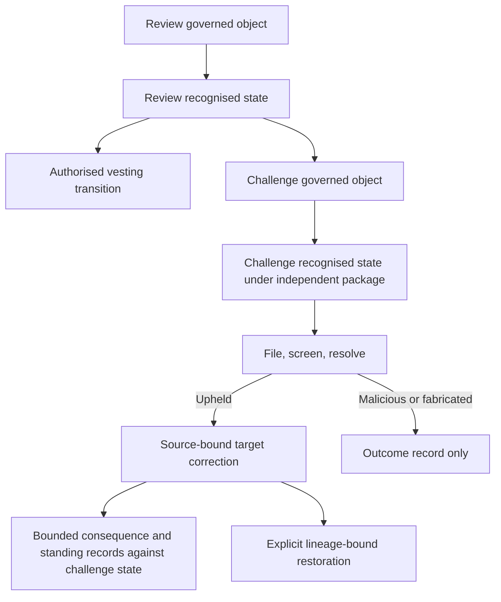
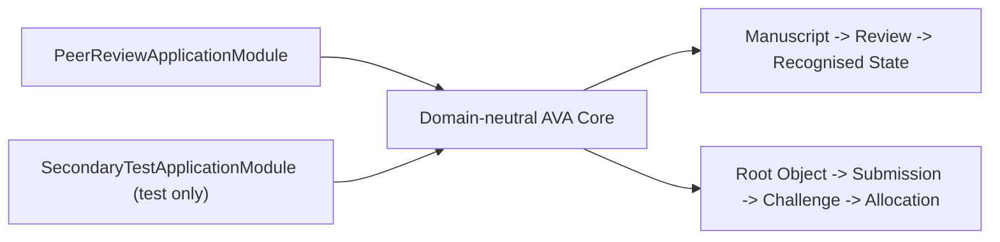
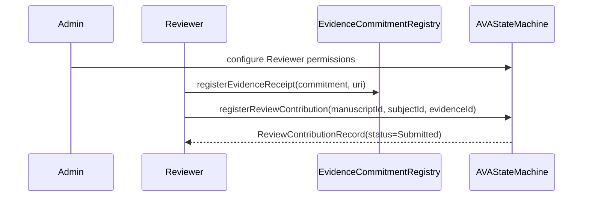
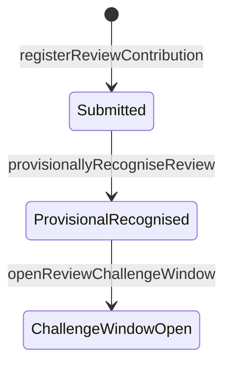
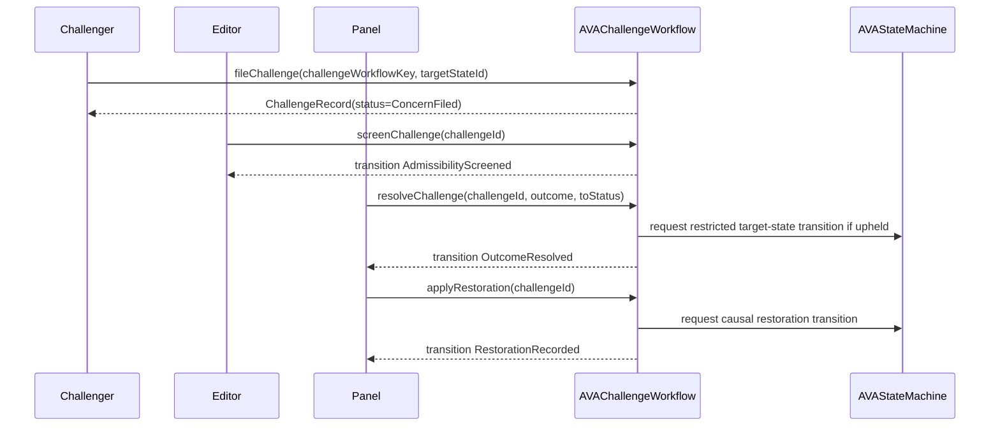
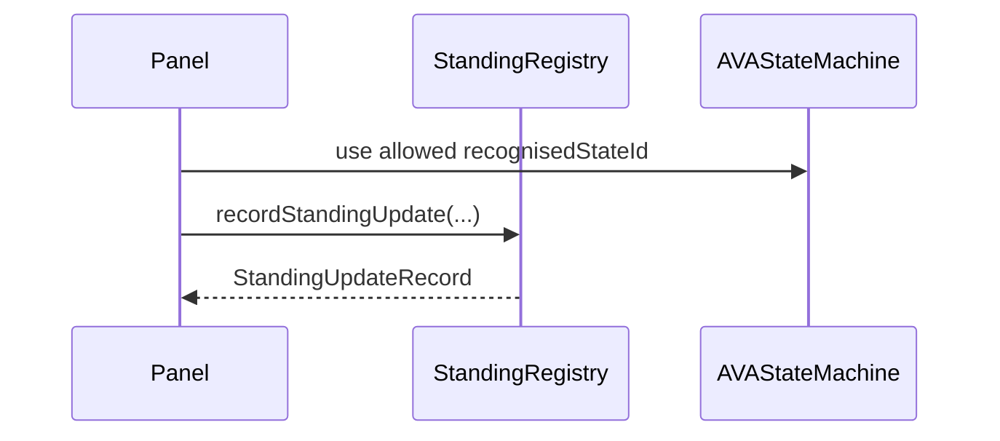
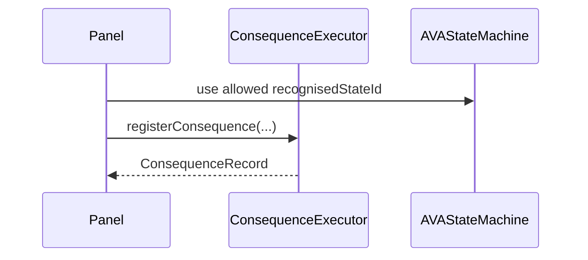
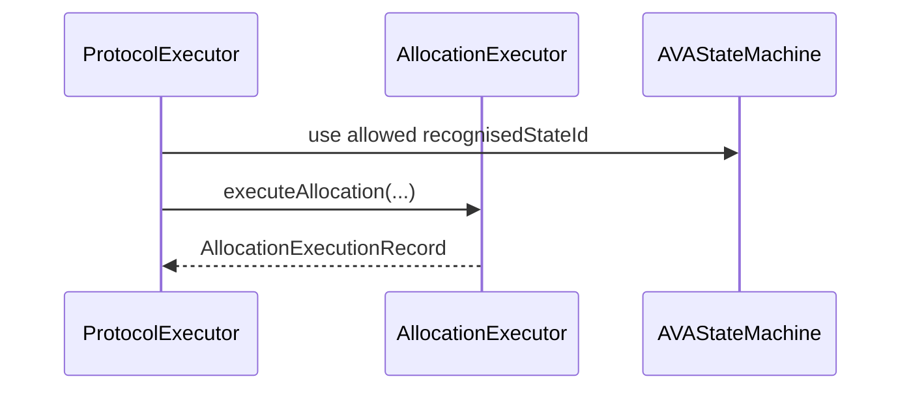
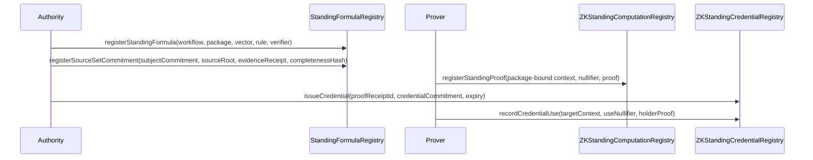

# Demo Scenarios

This file defines the canonical demo flows and identifies the older retained
regression scenarios separately.

The scenarios are examples for a peer review technical demo and early sample
of the AVA protocol. They are not production peer-review, publication, payment,
queue, disclosure-reveal, or sanction workflows.

Cross-application behavior is verified in Foundry tests rather than a public
second-application script. `test/helpers/SecondaryTestApp.sol` supplies neutral
roles and objects solely to test namespace, package, subject, evidence, state,
challenge, proof, and downstream-record isolation.

`script/AVACanonicalTrace.s.sol` is the paper/model handoff trace harness.
Run `AVACanonicalTrace --sig "runTrace()" --offline` to export four
deterministic scenario traces. The checked-in output is
`generated/canonical-scenario-traces.json`. The script returns the JSON; the
checked-in generated file is maintained as a repository artifact rather than
being rewritten automatically by the script. These traces name records and
transitions only; they do not encode sanction execution, truth decisions,
manuscript acceptance, merit scoring, or publication outcomes.

The canonical runtime command is:

```bash
forge script script/AVACanonicalTrace.s.sol:AVACanonicalTrace --sig "runTrace()" --offline
```

`script/AVADemoScenario.s.sol` exercises the pre-separation stack and is
available only through `FOUNDRY_PROFILE=retained`. It is not evidence for the
current canonical application/Core separation.

## Canonical Trace Scenarios



The generated trace contains four deterministic scenarios:

The review and challenge packages in this trace each bind the 12 capabilities
used by these scenarios. Extended standing and recovery test fixtures bind
additional capabilities separately; the trace is not intended to instantiate
the entire optional capability catalogue.

1. `honest_review_vesting`: a review object forms a recognised state and reaches
   `Vested` only through an authorised transition.
2. `upheld_recursive_challenge_and_downstream_records`: a challenge has its own
   object, recognised state, evidence, and package; an upheld decision corrects
   the target through its historical package and vests the challenge state
   before bounded downstream records use it.
3. `malicious_or_fabricated_challenge_record_only`: the outcome is recorded but
   does not automatically create a consequence or standing update.
4. `explicit_restoration_with_lineage`: restoration appends both challenge and
   recognised-state transition history instead of overwriting status.

## Retained Regression Scenarios

The numbered scenarios below document the earlier root-level implementation.
They remain useful regression coverage, but their contract names and entrypoints
must not be treated as the canonical architecture.

## Scenario 0: Application Isolation

Purpose: prove that Peer Review and a domain-neutral test fixture can share one
Core while keeping application vocabulary, subjects, evidence, package
pointers, objects, recognised states, challenges, and downstream records
isolated.



Current evidence:

- both applications deliberately reuse one `workflowKey` without pointer
  collision;
- package supersession in the secondary fixture does not move the Peer Review
  pointer;
- old states continue to dispatch through their historical package;
- cross-application object, evidence, challenge, transition, proof, and
  downstream references fail closed;
- a 512x128 handler-based invariant interleaves package replacement with
  cross-application attack attempts.

## Scenario 1: Register A Sealed Review Contribution

Purpose: show that raw review submission is an off-chain evidence reference,
not standing, reward, allocation, or manuscript advantage.



Expected checks:

- review evidence is stored as a commitment or pointer only;
- raw review has no recognised state id;
- standing input counter remains unchanged;
- consequence counter remains unchanged;
- no publication or manuscript merit function is called or exposed.

Current evidence:

- Covered by `testRawReviewAndChallengeDoNotCreateStandingRewardOrSanction`.
- Covered by `testReviewReceiptCanBecomeChallengeableRecognisedStateWithoutStandingOrReward`.

## Scenario 2: Provisional Recognition And Challenge Window

Purpose: show an authorised editor turning a review contribution into a
challengeable recognised state in the Verification stage.



Expected checks:

- only authorised editor role can provisionally recognise the review;
- recognised state stage is `Verification`;
- challenge window changes recognised state to `Challengeable`;
- no standing, consequence, reward, allocation, or manuscript advantage is
  created.

Current evidence:

- Covered by `testReviewReceiptCanBecomeChallengeableRecognisedStateWithoutStandingOrReward`.
- Covered by `testReviewerCannotProvisionallyRecogniseOwnReview`.

## Scenario 3: Challenge, Resolution, And Explicit Restoration

Purpose: show challenge/correction/restoration as authorised transitions over a
recognised state, not raw accusation effects.



Expected checks:

- challenge can target only an existing `Challengeable`, `Vested`, or
  `Restored` recognised state;
- challenge cannot target a raw review contribution;
- filing a challenge does not mutate the recognised state;
- editor can screen but cannot resolve;
- panel can resolve;
- challenger cannot resolve their own challenge;
- `RejectedGoodFaith`, `Negligent`, and `MaliciousOrFabricated` stay distinct;
- malicious/fabricated outcome records abuse finding but executes no sanction;
- restoration is explicit and preserves history;
- stale restoration cannot overwrite a later recognised-state mutation;
- challenge validation and decision authority use the challenge's fixed
  package, while target-state mutation uses the target state's fixed package;
- no standing, consequence, reward, allocation, or publication effect is
  created automatically.

Current evidence:

- Covered by `testChallengeCorrectionAndRestorationPathKeepsConsequencesBounded`.
- Covered by `testGoodFaithRejectedChallengeCanRestoreTargetWithoutSanction`.
- Covered by `testChallengerCannotResolveOwnChallenge`.
- Covered by `testRawChallengeCannotTargetRawReviewSubmission`.
- Covered by `testEditorCanScreenButCannotResolveChallenge`.
- Covered by `testChallengeOutcomesRemainDistinctWithoutAutomaticConsequences`.
- Covered by `testUnauthorisedCallerCannotRestoreOrCloseChallenge`.

## Scenario 4: Standing Update From Authorised Recognised State

Purpose: show procedural standing weight as a bounded record tied to recognised
state history.



Expected checks:

- raw review cannot create standing;
- raw challenge cannot create standing;
- only authorised role can record standing update;
- only allowed recognised-state statuses can support standing updates;
- standing update has no public prestige, reward, service entitlement, token,
  priority, acceptance, rejection, or manuscript merit effect.

Current evidence:

- Covered by `testAuthorisedPanelCanRecordProceduralStandingUpdateFromRecognisedState`.
- Covered by `testUnauthorisedCallerCannotRecordStandingUpdateOrExecuteAllocation`.
- Covered by `testStandingAndAllocationRejectRawIdsAndProvisionalState`.
- Covered by `testStandingAndAllocationRejectAllDisallowedRecognisedStateStatuses`.
- Covered by `testStandingAndAllocationRejectZeroRequiredFields`.
- Covered by `testRemovedStandingInputEntrypointCannotBeCalled`.

## Scenario 5: Bounded Consequence Record From Authorised Recognised State

Purpose: show administrative consequence recording as a bounded governance
record, not sanction or reward execution.



Expected checks:

- raw review cannot create consequence;
- raw challenge cannot create consequence;
- only authorised panel role can register consequence by default;
- editor cannot register consequence by default;
- only bounded consequence kinds are active;
- consequence registration has no standing, allocation, token, payment,
  sanction execution, reward, publication priority, or manuscript merit effect.

Current evidence:

- Covered by `testAuthorisedPanelCanRegisterBoundedConsequenceFromRecognisedState`.
- Covered by `testUnauthorisedAndEditorCallersCannotRegisterBoundedConsequenceByDefault`.
- Covered by `testBoundedConsequenceRejectsRawIdsDisallowedStatusesAndZeroFields`.
- Runtime path covered by `script/AVADemoScenario.s.sol:AVADemoScenario.run`.

## Scenario 6: Allocation Execution From Authorised Recognised State

Purpose: show AVA Allocation as a bounded authorised record.



Expected checks:

- raw review cannot execute allocation;
- raw challenge cannot execute allocation;
- only authorised protocol executor can execute allocation;
- allocation execution has no publication priority or manuscript merit effect;
- allocation remains a protocol record, not a scientific truth judgment.

Current evidence:

- Covered by `testProtocolExecutorCanExecuteBoundedAllocationFromRecognisedState`.
- Covered by `testUnauthorisedCallerCannotRecordStandingUpdateOrExecuteAllocation`.
- Covered by `testStandingAndAllocationRejectRawIdsAndProvisionalState`.
- Covered by `testStandingAndAllocationRejectAllDisallowedRecognisedStateStatuses`.
- Covered by `testStandingAndAllocationRejectZeroRequiredFields`.

## Scenario 7: No-Publication-Advantage Boundary

Purpose: prove the ABI does not expose functions that decide or influence
manuscript acceptance, rejection, merit, review score, score boost, or
publication priority.

Current evidence:

- Covered by `testNoPublicationDecisionOrManuscriptMeritSelectorsExist`.
- Runtime path covered by `script/AVADemoScenario.s.sol:AVADemoScenario.run`.

## Scenario 8: Universal AVA Module Scaffold

Purpose: show that different AVA workflows can bind different stage and rule
modules while sharing the same recognised-state substrate.

Expected checks:

- a review-service workflow package and a challenge/integrity workflow package
  can both be registered;
- both workflows converge on `RecognisedStateRecord` in `AVAStateMachine`;
- disclosure behavior can vary by stage, action, and object through the module
  interface;
- allocation and consequence modules can be swapped without changing the fixed
  substrate;
- swapped modules validate or reject records only, and do not reveal identity,
  transfer value, execute sanctions, score truth, or create publication
  advantage.

Current evidence:

- Covered by `testM4MultiWorkflowScenarioPreservesSharedSubstrateAndBoundaries`.
- Covered by `testChallengeWorkflowCanDifferFromTargetRecognisedStatePackage`.
- Covered by `testDisclosureModuleCanVaryByStageActionAndObject`.
- Covered by `testAllocationAndConsequenceModulesAreReplaceableAndRecordOnly`.


## Scenario 9: Privacy-Preserving Standing Proof And Commitment-Bound Credential

Purpose: show that standing can be proven without exposing the account or full
source history that produced the standing computation. This is a chain-side
commitment and proof-use scenario, not a production ZK circuit or a reputation
token.



Expected checks:

- formula metadata and source-set commitments are registered before a ZK
  standing proof receipt can be accepted;
- the proof receipt is bound to stable `packageId`, subject commitment, vector,
  category/range, epoch, source-record-set root, computation-rule hash,
  verifier, and nullifier;
- the commitment-bound credential stores no owner account and exposes no
  transfer, approval, balance, reward, priority, publication, reveal, or
  manuscript-merit surface;
- proof use requires a verifier proof and rejects replayed nullifiers;
- the chain does not compute full standing history, traverse source records, or
  prove source-set completeness by itself.

Current evidence:

- tests cover package-bound standing proof receipts;
- tests reject proof replay and bad subject binding;
- tests reject cross-package proof reuse after workflow supersession;
- tests require registered formula and source-set commitment records;
- tests reject unauthorised, wrong-package, wrong-evidence, and wrong-verifier
  standing formula paths;
- tests issue commitment-bound credentials without exposing an account owner;
- tests reject credential proof-use nullifier replay;
- tests require credential-holder proof before proof-use succeeds.
