# AVA-PeerReview State Machines

`AVAGovernanceKernel` stores recognised states and their transitions.
`AVAChallengeExtension` stores challenges and requests corrections or
restorations from the kernel. Later sections describe the earlier
`AVAStateMachine` and `AVAChallengeWorkflow` for retained regression tests.

## Canonical Multi-Application State Path

```mermaid
sequenceDiagram
    participant Actor
    participant Evidence as AVAEvidenceRegistry
    participant Core as AVAGovernanceKernel
    participant Router as AVAWorkflowPolicyRouter
    participant Package as Package Modules
    participant Challenge as AVAChallengeExtension

    Actor->>Evidence: registerEvidence(appId, workflowKey, packageId, subjectId)
    Actor->>Core: registerGovernedObject(...)
    Core->>Package: validate governed object and attribution
    Actor->>Core: formRecognisedState(objectId, status)
    Core->>Router: validateFormation(package-bound context)
    Router->>Package: verification, evidence, disclosure, authority, optional policies
    Core-->>Actor: RecognisedStateRecord(appId, packageId, lastTransitionId)
    Actor->>Core: transitionRecognisedState(...) or vestRecognisedState(...)
    Core->>Router: validateTransition(package-bound context)
    Router->>Package: transition, evidence, disclosure, authority, optional policies
    Core-->>Actor: RecognisedStateTransitionRecord
    Actor->>Challenge: optional recursive challenge lifecycle
    Challenge->>Core: request source-bound correction or restoration
```

The generic status set is `None`, `Draft`, `Registered`, `Provisional`,
`Challengeable`, `Vested`, `Frozen`, `Downgraded`, `Voided`, and `Restored`.
Direct formation cannot create `Vested`, `Downgraded`, `Voided`, or
`Restored`. Generic transitions cannot create correction/restoration states.
Challenge correction and restoration must use the restricted extension-to-
Core request path and always append a generic transition record.

Challenge evidence must remain active and bound to the challenge's historical
application, workflow, package, subject, and disclosure policy for screening,
resolution, restoration readiness, or restoration application. If that
evidence becomes inactive, an authorised actor may still close the challenge
without recording an outcome or mutating the recognised state.

## Canonical Recursive Challenge Path

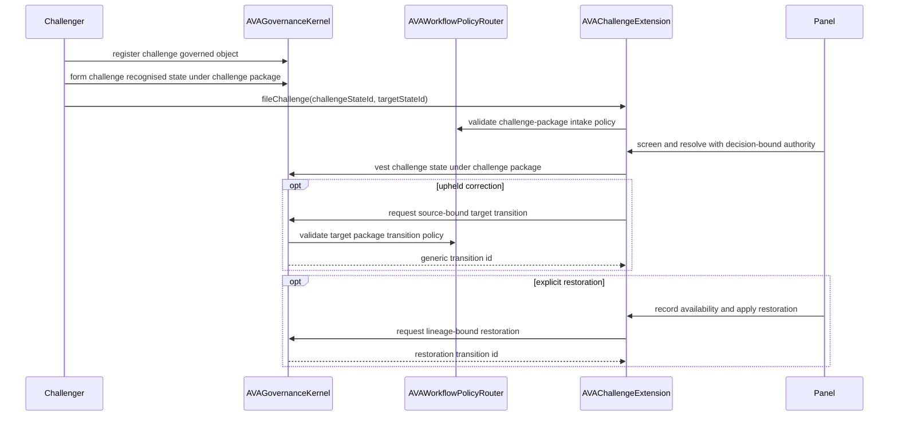

The challenge is therefore a recursive AVA workflow, not an accusation-only
side table. Its object, evidence, recognised state, lifecycle, and package are
independent of the target's package. A raw filing never mutates the target or
creates standing, allocation, consequence, settlement, or publication effects.
Only the challenge extension may request correction/restoration, and the Core
still applies the target's historical package plus `AVACoreTransitionRules`.

`appId`, stored `packageId`, responsible `subjectId`, pinned evidence,
disclosure policy, and `lastTransitionId` travel together. The same workflow
key may be active in Peer Review and a test-only secondary application, but
their application-scoped records and pointers cannot cross.

Governed-object parentage follows the same rule. Core requires a parent in the
same application and a package with the same compatibility key, then passes
the parent's workflow, package, object type, and subject to the application
module. Peer Review narrows review-to-manuscript parentage to the same workflow
while allowing a challenge object to use a distinct compatible workflow.

State-derived evidence use also compares the receipt's disclosure policy with
the source state's policy. A same-package receipt under a different policy
cannot be substituted by a permissive module.

Challenger-side findings, challenge-transition audits, and challenge-target
external-operation requests use the challenge recognised state, package,
subject, and evidence. Target-side upheld findings use the challenged state.
This keeps recursive challenge records reconstructible instead of combining
the target state with challenger provenance.

For Peer Review challenge states, the application transition context also
carries `actionKey` and `sourceRecordId`. `Registered -> Challengeable` requires
the `FileChallenge` action and a nonzero challenge source; challenge-state
vesting requires a recorded resolution source. Direct generic transition
permission cannot substitute for filing. Review objects accept only
irresponsible-review findings, while challenge objects accept only negligent or
malicious/fabricated-challenge findings.

## Retained Reference Map

The detailed sections below preserve the pre-separation
`AVAStateMachine`/`AVAChallengeWorkflow` behavior for regression readers. They
are not alternate canonical entrypoints. Use the canonical sections above and
`script/AVACanonicalTrace.s.sol` for current architecture claims.

- For the review path, read `Review Contribution Path`,
  `Recognised State Statuses`, and `Challenge Lifecycle`.
- For mutation rules, read `Challenge Outcomes` and `Transition Record
  Requirement`.
- For package dispatch and module coverage, read `Module Registry Boundary`.
- For standing, allocation, consequence, reward, priority, penalty,
  restoration, credential, settlement, and proof records, read
  `Standing And Allocation`.

## Review Contribution Path

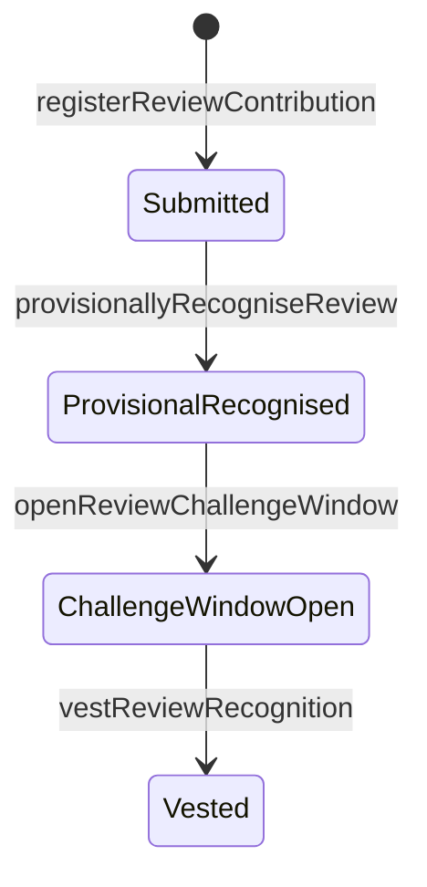

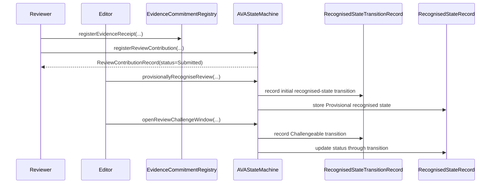

Rules currently enforced:

- `registerReviewContribution` requires `RegisterReviewContribution`, an
  existing manuscript id, a caller-bound reviewer subject, and a registered
  evidence receipt.
- raw `Submitted` review has no recognised state id.
- `provisionallyRecogniseReview` requires `ProvisionallyRecogniseReview`.
- provisional recognition creates a `RecognisedStateRecord` in AVA stage
  `Verification`.
- `openReviewChallengeWindow` requires `OpenChallengeWindow`.
- opening the window sets the linked recognised state to `Challengeable` and
  records the chain timestamp readable through
  `getChallengeWindowOpenedAt(recognisedStateId)`.
- `vestReviewRecognition` requires `TransitionRecognisedState`, rejects if the
  linked recognised state has any unclosed challenge, enforces the deployed
  state machine's immutable nonzero minimum challenge-window duration, calls
  any selected `IChallengeWindowRuleModule` for an additional timing veto,
  writes a generic recognised-state transition, and sets the linked recognised
  state to `Vested`.
- the substrate permits only one simultaneously open challenge for the same
  challenger subject or filing account and recognised state, and only one
  filing by either identity against the same recognised-state transition
  version. Rotating the account's canonical challenger subject does not reset
  either cap. Default anti-abuse
  modules remain a permissive module baseline above that hard floor, while
  packages that select `SubjectRateLimitModule` can reject repeated challenge
  filings across later target versions for the same package path.
- none of these steps creates standing, consequence, reward, sanction,
  allocation, service entitlement, or manuscript advantage.

## Recognised State Statuses

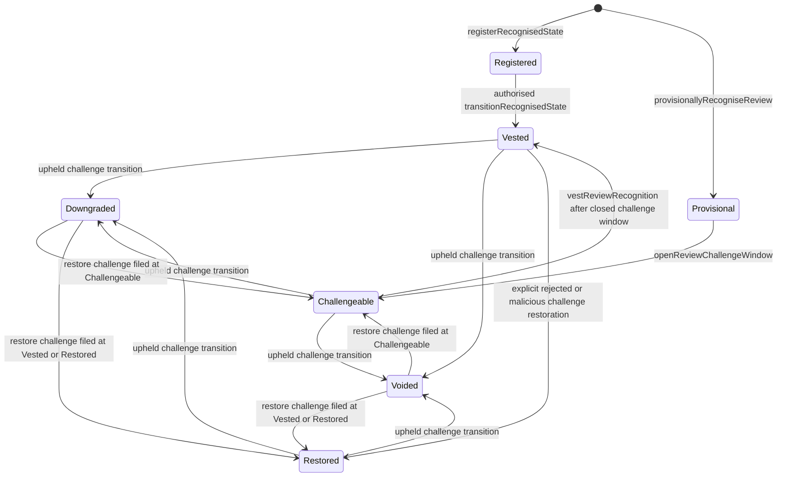

`Draft` and `Frozen` exist in the enum but are not currently moved by the
implemented review/challenge path. Direct public recognised-state registration
cannot create `Vested`, `Restored`, `Downgraded`, or `Voided`. Those
downstream-eligible statuses must be reached through authorised transition
paths that pass transition-rule validation and write generic recognised-state
transition records.
Rejected-good-faith or malicious/fabricated restoration on an unchanged
`Challengeable` target writes an explicit challenge transition but leaves the
recognised-state status and generic transition id unchanged. It cannot upgrade
that target to `Restored`.

`script/AVATransitionMatrix.s.sol` generates the matrix in
`generated/recognised-state-transition-matrix.csv` from `AVACoreTransitionRules`.
Tests check the row count, representative rows, and the hash. Separate tests
run vesting, correction, and restoration through public contract calls. The
330 rows cover
all recognised-state enum values: 10 formation cases, 100 generic from/to
pairs, 10 vesting sources, 10 challenge-target statuses, 100 challenge-
correction from/to pairs, and 100 restoration from/to pairs. The canonical
artifact therefore contains 330 rule rows and is pinned by hash
`0x9cba1aa4d1a8141ded47fb76ad2a2f2d96a4a83608a76bbf29e1bbe48e73dd97`.

## Challenge Lifecycle

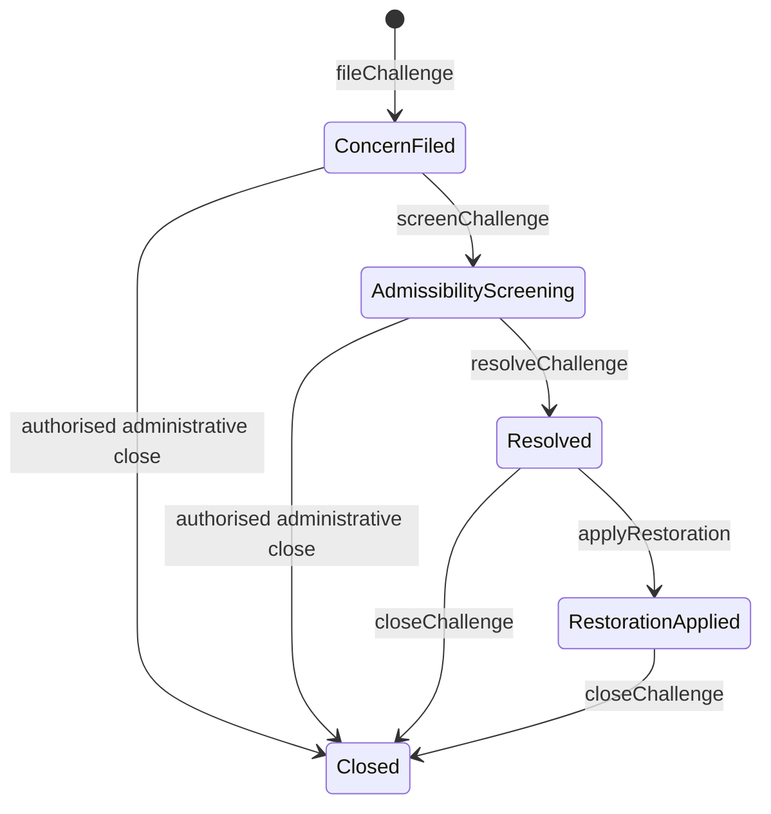

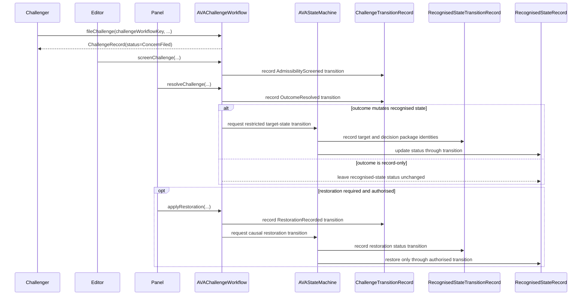

Rules currently enforced:

- `fileChallenge` requires `FileChallenge`, a caller-bound challenger subject,
  and a registered evidence receipt.
- the target must be an existing recognised state with status `Challengeable`,
  `Vested`, or `Restored`.
- the target cannot be a raw review contribution.
- filing creates only a `ChallengeRecord`.
- the challenge package and target package must share the same stable
  `compatibilityKey` at filing. Resolution and restoration pass the residual
  authority validators of both packages when they differ; target mutation still
  uses the target package's historical transition rule.
- `screenChallenge` requires `ScreenChallenge`; the screening authority account
  must be distinct from both the challenger and the responsible target account.
- screening records an `AdmissibilityScreened` transition and does not decide
  truth or wrongdoing.
- `resolveChallenge` requires `ResolveChallenge`.
- the challenger and responsible target accounts cannot resolve the challenge,
  including through different role-scoped authority subjects.
- resolution records an `OutcomeResolved` transition.
- an authorised, conflict-free panel may close a filed or screened challenge
  with outcome `None`. This writes only a `Closed` challenge transition,
  releases the open-challenge count and filing cap, and does not mutate the
  recognised state.
- a ZK-backed anonymous challenge package can require separate action-bound
  proof receipts for filing, screening, and resolution.
- anonymous challenge proof-use receipts bind to `RecordDisclosureExecution`
  context, target challenge id, subject commitment, package id, policy id,
  proof receipt, and nullifier, so a `FileChallenge` proof cannot be reused as
  proof-use.
- only an upheld challenge may correct the recognised state to `Downgraded` or
  `Voided`; a `Voided` state cannot be reversed to `Downgraded` by a later
  challenge.
- `applyRestoration` requires `ApplyRestoration`.
- restoration records a `RestorationRecorded` transition and preserves prior
  challenge history. It is causal: the target must still be in the status
  written by that challenge's resolution transition. A stale challenge cannot
  overwrite a later recognised-state mutation.
- the restoration target is derived from `targetStatusAtFiling`: filing at
  `Challengeable` restores to `Challengeable`, while filing at `Vested` or
  `Restored` may restore to `Restored`.
- each recognised state stores `lastTransitionId`; each challenge stores
  `targetStatusAtFiling` and `targetTransitionIdAtFiling`; challenge-transition
  records store `targetTransitionIdBefore` and `targetTransitionIdAfter`.
  Decision hashes include the challenge lifecycle status, latest
  challenge-transition id, and target transition id, so approval cannot replay
  across either challenge or recognised-state versions.
- `closeChallenge` requires `CloseChallenge` and applies the same account-level
  conflict exclusion as screening, resolution, and restoration. It can close a
  filed or screened challenge without deciding an outcome. Receipt-backed
  close authority may be recorded after challenge evidence becomes terminal,
  but remains bound to the exact challenge, object, lifecycle version, target
  version, and close decision hash. Recursive challenge resolution,
  restoration, and close validate residual authority under both the challenge
  package and the target state's fixed package before mutation or open-count
  release.

Challenge lifecycle admissibility is validated through the challenge workflow
package's
`IChallengeLifecycleModule`. The default package uses
`DefaultChallengeLifecycleModule`, preserving the current lifecycle order.
`AVAChallengeWorkflow` owns challenge and challenge-transition storage. It uses
the challenge's fixed package for evidence, attribution, verification,
disclosure, lifecycle, anti-abuse, and decision-authority validation.
`AVAStateMachine` owns recognised-state storage and the generic transition
ledger. Its one-time-bound challenge workflow is the only external contract
that can request challenge-driven status changes, and the target state's fixed
package still controls transition-rule validation. Both contracts retain
non-delegable subject, authority, evidence, lifecycle, and conflict gates.
Each governed transition rechecks its pinned evidence receipt against the
record's historical workflow/package and calls that package's evidence
lifecycle module. Evidence content, quality, and truth remain outside the
contract.

## Challenge Outcomes

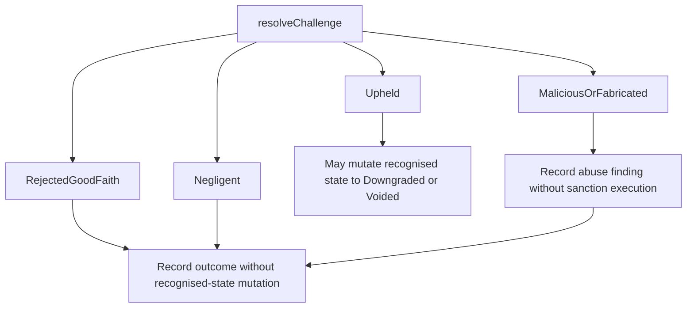

Current outcome effects:

- `Upheld`: may mutate the challenged recognised state to `Downgraded` or
  `Voided` through an authorised transition record.
- `RejectedGoodFaith`: records the outcome without sanction.
- `Negligent`: records the outcome without automatic sanction.
- `MaliciousOrFabricated`: records an abuse finding without automatic sanction.

## Transition Record Requirement

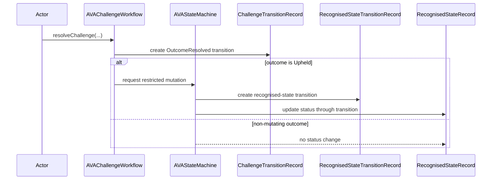

Every implemented challenge resolution or restoration path records a
`ChallengeTransitionRecord` in `AVAChallengeWorkflow`. Every recognised-state
creation or status mutation also records a generic
`RecognisedStateTransitionRecord` in `AVAStateMachine` and emits a
`RecognisedStateTransitionRecorded` event. Challenge-driven entries bind both
the target `packageId` and the challenge decision `decisionPackageId`.

## Publication Boundary

The current ABI tests check that publication-decision and manuscript-merit
selectors are absent. The current contracts do not expose manuscript acceptance,
rejection, merit, score boost, publication priority, or publication decision
functions.

## Module Registry Boundary

`AVARulePackageRegistry` stores workflow-level module bindings for
Attribution, Verification, TransitionRule, Disclosure, Allocation, Standing,
Reward, Priority, Consequence, Penalty, Restoration, ChallengeLifecycle,
EvidencePolicy, Audit, EditorialSystem, ResidualEditorialAuthority,
DisclosureLifecycle, FieldPolicy, and AntiAbuse.
`AVARulePackageLifecycleRegistry` separately owns package-lifecycle,
object-migration-readiness, and disclosure-lifecycle-readiness records. Its
constructor fixes the authority, package, disclosure-policy, recognised-state,
and evidence readers; the package catalog no longer carries mutable readiness
reader configuration.

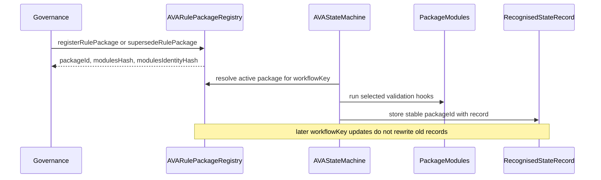

The challenge lifecycle binding uses `IChallengeLifecycleModule`; the default
implementation is `DefaultChallengeLifecycleModule`. The registry does not
create another state machine. Registered modules and adapters validate or
reject records around the fixed substrate:

- role-scoped subjects stay in `RoleIdentityRegistry`;
- authority stays in `AuthorityMatrix`;
- evidence references and evidence-registering role-scoped subjects stay in
  `EvidenceCommitmentRegistry`;
- disclosure policy references stay in `DisclosurePolicyRegistry`;
- recognised states stay in `AVAStateMachine`;
- challenges and challenge transitions stay in `AVAChallengeWorkflow`;
- audit receipts stay in `AttestationAuditModule`; workflow-aware audit records
  must carry a role-scoped authority subject, and evidence/state/transition
  audits use the audited receipt or target object's stable package identity.

Current tests use this scaffold to show a review-service workflow and a
challenge/integrity workflow sharing the same recognised-state substrate.
`AVAWorkflowValidator` centralises package-bound attribution, verification,
evidence, disclosure, field-policy, and anti-abuse checks. `AVAStateMachine`
uses it for manuscript, review, and recognised-state formation;
`AVAChallengeWorkflow` uses it with the independently selected challenge
package. Residual authority validation is decision-bound while the state
machine keeps recognised-state storage and mutation gates. The resulting review
contribution, recognised state, challenge, transition, and downstream records
bind the stable package identities used at creation or decision time.
`StandingRegistry`, `AllocationExecutor`,
`ConsequenceExecutor`, and target-bound audit paths dispatch adapters by
reading the target recognised state, transition, challenge transition, or
evidence receipt `packageId`, not by reloading the current package for the
workflow key. Evidence receipts used to form workflow objects or downstream
records must belong to the same workflow as the object or target recognised
state; cross-workflow evidence references are rejected as substrate errors.
Scenario tests cover that historical binding across double-blind review
vesting, anonymous challenge proof-use/resolution, and correction/restoration
records after same-workflow supersession.

Current module coverage:

| Family | Interface | Default module | Example module | Workflow binding | Current limit |
| --- | --- | --- | --- | --- | --- |
| Attribution | `IAttributionModule` | `DefaultAttributionModule` | `SubjectSaltAttributionModule` | Rule package | Validates attributed object only |
| Verification | `IVerificationModule` | `DefaultVerificationModule` | `EvidenceThresholdVerificationModule` | Rule package | Validates references, not truth |
| Transition rule | `ITransitionRuleModule` | `DefaultTransitionRuleModule` | `NoFrozenTransitionRuleModule`, `MinimumChallengeWindowTransitionModule` | Rule package | Cannot own state storage; optional challenge-window timing veto before vesting when the module declares support |
| Disclosure/privacy | `IDisclosurePolicyModule` | `DefaultDisclosurePolicyModule` | disclosure scenario modules, `ZKBackedDisclosureModule` | Rule package and evidence registry | No reveal or decryption |
| Challenge lifecycle | `IChallengeLifecycleModule` | `DefaultChallengeLifecycleModule` | `PanelOnlyChallengeLifecycleModule` | Rule package | Admissibility only |
| Evidence policy | `IEvidencePolicyModule` | `DefaultEvidencePolicyModule` | `TypedEvidencePolicyModule` | Rule package | Active on workflow-scoped evidence registration and recognised-state validation; reference/type/workflow validation only |
| Audit adapter | `IAuditAdapter` | `DefaultAuditAdapter` | `HashAnchoredAuditAdapter` | Evidence receipt or target `packageId` | Active on workflow-aware and target-bound attestation paths; substrate records target kind/action while adapters validate reference and authority-subject context only |
| Editorial adapter | `IEditorialSystemAdapter` | `DefaultEditorialSystemAdapter` | `EditorialReferenceAdapter` | Rule package | Workflow-aware manuscript overload requires a known package; adapter is active only when optional external reference metadata is supplied |
| Residual editorial authority | `IResidualEditorialAuthorityModule` plus `AuthorityApprovalRegistry` for receipt-backed examples | `DefaultResidualEditorialAuthorityModule` | `ProceduralEditorialAuthorityModule`, `IllustrativeStaticAuthorityShapeModule`, `ApprovalReceiptAuthorityModule`, `CredentialGatedPanelModule` | Rule package | Procedural authority validation only. Static examples cover a single authority or emergency gate. Real m-of-n approval uses distinct canonical-subject receipts with optional conflict exclusion. No generic multisig or cross-role institutional co-signature implementation is claimed, and no authority module decides publication or merit. |
| Field policy | `IFieldPolicyModule` | `DefaultFieldPolicyModule` | `DisciplineFieldPolicyModule` | Rule package | Active on recognised-state validation; discipline rule validation only |
| Anti-abuse | `IAntiAbuseModule` / optional `IChallengeRateLimitModule` | `DefaultAntiAbuseModule` | `SubjectRateLimitModule`, `RestrictionAwareChallengeIntakeModule` | Rule package | Active on review, challenge, and downstream record paths; default package is a permissive baseline; example modules can veto selected subject/object/action paths, repeated challenge filings, or active challenge-intake eligibility restrictions; no sanction execution |
| Standing | `IStandingAdapter` | `DefaultStandingAdapter` | `VectorStandingAdapter` | Recognised-state `packageId` | Procedural weight record only |
| Reward/value | `IRewardAdapter` | `DefaultRewardAdapter` | `StablecoinRecordRewardAdapter`, `GenericTokenRecordRewardAdapter` | Recognised-state `packageId` | Adapter validates bounded records; mock settlement execution is separate and package/asset bound |
| Priority | `IPriorityAdapter` | `DefaultPriorityAdapter` | `PriorityTokenRecordAdapter`, `RentedPriorityRecordAdapter` | Recognised-state `packageId` | Administrative queue record only |
| Penalty | `IPenaltyAdapter` | `DefaultPenaltyAdapter` | `ProceduralPenaltyRecordAdapter`, `PriorityReturnObligationRecordAdapter` | Recognised-state `packageId` | Record only, no sanction execution |
| Restoration | `IRestorationAdapter` | `DefaultRestorationAdapter` | `RestorationProcedureRecordAdapter`, `CorrectionRestorationRecordAdapter` | Recognised-state `packageId` | Repair record only |
| General consequence | `IConsequenceAdapter` | `DefaultConsequenceAdapter` | `BoundedConsequenceExampleAdapter` | Recognised-state `packageId` | Administrative/procedural record only |
| Disclosure lifecycle readiness | `IDisclosureLifecycleModule` | `DefaultDisclosureLifecycleModule` | `RejectingDisclosureLifecycleModule` | Rule package | Readiness records only; no reveal, decrypt, ACL engine, or identity disclosure |

Reference-integrity checks add substrate-level disclosure policy existence
checks before disclosure-lifecycle readiness records and require
`ZKProofRegistry` proof receipts to reference a known active workflow package
and a registered disclosure policy, and to store the active package id for the
proof context. These remain receipt/readiness checks only; they do not reveal
identity or content.

## Standing And Allocation

This section is a reference checklist for downstream surfaces. The short rule
is:

- only eligible recognised-state statuses can support downstream records;
- raw review ids, raw challenge ids, raw evidence ids, unknown ids, inactive
  subjects, unsupported statuses, and cross-package references are rejected;
- standing, credentials, consequences, allocations, settlements, and external
  operation receipts stay source-bound and do not create publication,
  manuscript-merit, reveal, sanction-execution, or standing-token effects.

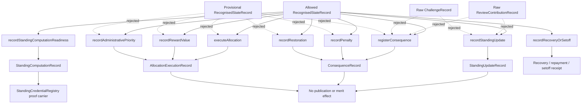

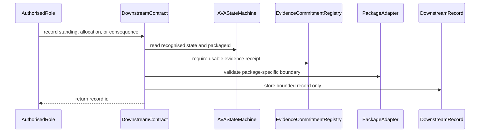

Allowed recognised-state statuses for consequences, standing updates,
allocation execution, reward/value records, administrative-priority records,
penalty records, and restoration records:

- `Vested`
- `Restored`
- `Downgraded`
- `Voided`

Rules currently enforced:

- `registerConsequence` requires `RegisterConsequence`.
- `recordPenalty` and `recordRestoration` require `RegisterConsequence`.
- `recordStandingUpdate` requires `RecordStandingUpdate`.
- `executeAllocation` requires `ExecuteAllocation`.
- `recordRewardValue` and `recordAdministrativePriority` require
  `ExecuteAllocation`.
- consequences, standing, allocation, reward/value, administrative priority,
  penalty, and restoration reject raw review ids, raw challenge ids, unknown
  recognised-state ids, unsupported recognised-state statuses, and unknown or
  inactive target subjects.
- `evidenceReceiptId` must be nonzero, registered, workflow-scoped, package
  bound, and currently `Active` in `EvidenceCommitmentRegistry`; upstream
  review, recognised-state, and challenge formation also reject unknown,
  cross-workflow, unscoped, or non-active evidence ids. Downstream paths apply
  the same usable-evidence check. These paths do not validate scientific truth,
  disclosure eligibility, or evidence content.
- authority ids representing the acting authority must match the caller's
  active role-scoped subject.
- recognised states store the responsible role-scoped subject. Standing and
  ordinary consequence / penalty / restoration records that target a
  recognised state use that subject. The explicit exception is a negligent or
  malicious/fabricated challenger finding: it is challenge-linked, uses the
  challenge package and evidence, and targets the recorded challenger subject.
- downstream adapters are selected from the applicable recorded package id, so
  explicit workflow supersession cannot rewrite old behaviour. Target-side
  effects use the recognised state's package; challenger-side findings use the
  challenge's package.
- consequence registration does not create standing or allocation records.
- standing updates do not create allocation or consequence records.
- allocation executions do not create standing or consequence records.
- reward/value, administrative-priority, penalty, recovery, setoff, waiver,
  satisfaction, and restoration records are adapter surfaces and route through
  value-execution readiness validation where relevant.
- penalty is decomposed into value recovery, standing penalty input, and
  eligibility / screening consequence. Standing penalty input is consumed by
  later standing computation; it is not a token deduction or balance update.
- standing penalty input requires a nonzero compatible challenge outcome:
  upheld for academic-fraud or irresponsible-review inputs, negligent for
  negligent-challenge inputs, and malicious/fabricated for malicious-challenge
  inputs. Rejected good-faith challenges cannot create misconduct standing
  penalty input.
- reward and penalty reversal is append-only: grant, execution, freeze, void,
  repayment obligation, setoff, waiver, satisfaction, reversal, and restoration
  records are retained rather than deleted.
- active recovery is source-bound and append-only: a completed origin token
  transfer or escrow claim must match package, subject, asset, payer, and full
  amount; it then links to one compatible penalty consequence, one repayment
  obligation, and exactly one terminal clawback, setoff, waiver, or satisfaction
  receipt. Only clawback moves the configured mock asset. External calls occur
  after settlement and revision state has been written, and reentrancy is
  rejected. Clawback revalidates the consequence package identity and evidence
  lifecycle; record-only setoff, waiver, and satisfaction remain available to
  close an existing obligation. Open or refunded escrow sources cannot start
  recovery chains.
- standing, allocation, and consequence record creation invokes the historical
  package's action-scoped evidence-lifecycle module after checking receipt
  status and package binding. Active non-refund settlement also revalidates the
  package identity and invokes that module for `ExecuteValueSettlement`.
- active allocation settlement revalidates the current source state, its pinned
  evidence, and the allocation evidence. A new repayment obligation also
  requires the linked penalty evidence to remain active. Escrow refund remains
  available after source-evidence invalidation, package-identity drift, or
  recipient-subject deactivation because it returns an existing deposit to the
  original payer rather than creating a new benefit.
- generic allocation and generic consequence records also route through the
  same value-execution readiness surface, with parameterized record-only asset,
  payer, amount/units, mode, execution-reference, authority, evidence, and URI
  fields.
- the execution-readiness flow is: authorisation, recognised-state gate,
  execution context validation, evidence reference check, recognised-state
  package lookup, anti-abuse, value execution adapter, domain adapter,
  record-only storage.
- rule-package lifecycle, evidence lifecycle, and standing-computation
  readiness surfaces record metadata only. Rule-package lifecycle readiness
  includes lifecycle kind plus stable target package metadata for
  migration/supersession records; it still does not execute migration, reveal
  evidence, adjudicate truth, or compute public reputation.
- standing credential issuance can consume an authorised standing-computation
  record and write only a non-transferable, expiring, revocable/supersedable
  proof carrier. It does not create standing, reputation, reward, priority,
  allocation, consequence, publication, or manuscript-merit effects.
- an expired or stale-revision ZK credential remains unable to prove but may be
  explicitly superseded by a fresh proof with a later epoch for the same
  canonical key; the old record retains replacement lineage and cannot lock the
  issuance slot permanently.
- standing source-set, completeness-attestation, computation-statement, ZK
  proof, and ordinary/ZK credential issuance paths revalidate their historical
  package identity and invoke its evidence-lifecycle module with the exact
  record action. If a module's identity changes, new writes revert and existing
  proofs become unusable.
- standing credential proof is package-, subject-, vector-, category-,
  threshold-, and range-bound. Ordinary and ZK issuers enforce a 365-day
  maximum validity period.
- ordinary standing computation and credential proof fail closed when the
  role-scoped subject is deactivated or the source evidence receipt becomes
  non-active.
- `StandingRevisionRegistry` tracks the latest standing revision for each
  package and subject. Relevant recognised-state, challenge, standing, penalty,
  eligibility, reward, and recovery events advance it without computing
  standing. An upheld challenge mutation advances the target revision through
  the recognised-state transition exactly once; challenge resolution does not
  repeat that target update. Standing-computation records bind the current
  revision together with epoch, source-record-set hash, computation-rule hash, and
  active/superseded/invalidated status. Credentials can prove only while the
  source computation remains active and its revision remains current. An
  authorised panel may advance the same watermark for an anonymous subject
  commitment through an evidence-backed, package-bound commitment-revision
  receipt; the path records no account or identity link.
- On the canonical path, each record-driven revision writer is bound to an
  explicit `packageId` before revision use starts for that package. First use
  seals that package's writer set without globally blocking writer setup for a
  different package. Every write rechecks the
  package application and subject application, preventing a writer from one
  package from invalidating another package's credential surface.
- the Formula V0 standing-computation example validates bounded reversible
  outputs for the four demo vectors. It does not compute complete historical
  standing and does not apply standing.
- ZK standing computation receipts bind active workflow package, subject
  commitment, vector/category/range, source-record-set root, computation-rule
  hash, exact registered formula/source-set commitment, active source-set
  completeness attestation, active computation statement, output commitment,
  formula version, source-set policy hash, verifier reference, proof-domain
  hash, and nullifier. They support future privacy-preserving credential
  issuance gates but do not reveal identity or compute full standing history on
  chain.
- formula/source-set/statement records bind workflow package, formula
  version, source-set policy hash, decay/cap/restoration policy hashes, source
  evidence receipt, source-record-set root, verifier reference, completeness
  attestation hash, output commitment, and authority before a ZK standing proof
  receipt can be accepted. They are the chain-side trust boundary for off-chain
  or future-ZK standing computation: they make the formula/source-set/output
  claim auditable, but they do not calculate standing, traverse full history, or
  prove source-set completeness by themselves.
- ZK standing credentials are commitment-bound proof carriers issued from ZK
  standing computation receipts. They bind package, subject commitment,
  credential commitment, vector/category/range, epoch, source-record-set root,
  computation-rule hash, expiry, and authority. Proof-use records require a
  verifier proof whose public key matches the stored credential commitment and
  reject replayed use nullifiers. Proof and use contexts bind chain id,
  registry deployment, and verifier deployment; use contexts additionally bind
  the beneficiary and reject copied submissions from another caller. Verifier
  runtime codehash and proof domain are pinned, and direct drift disables active
  proof use. They expose no owner account, balance,
  transfer, approval, reward, priority, reveal, publication, or manuscript-merit
  surface.
- credential proof checks also require the source computation statement
  referenced by the ZK proof receipt to remain active. Superseded or invalidated
  statements, or non-active evidence bound to the source set, completeness
  attestation, or statement, stop supporting stale credential proof without
  deleting prior proof or credential history.
- source-bound ZK credential suspension records require either a matching
  value-settlement record or a matching challenge transition record. Good-faith
  rejected challenges cannot suspend a credential as misconduct; negligent and
  malicious/fabricated challenge transitions can be recorded as
  standing-relevant suspension sources without executing sanctions or standing
  updates.
- standing-relevant settlement impact records suspend the subject's active
  standing credential before it can be used as proof again unless a fresh
  standing computation issues a new credential. The referenced value-settlement
  record must exist and match the same source, subject, package identity, and
  settlement kind. Unrelated settlement sources cannot suspend a credential.
  Relevant settlements include reward execution, voiding, downgrade,
  restoration, penalty input, repayment obligation, setoff, waiver,
  satisfaction, credential suspension, and eligibility restoration.
- governance-memory records can be read by validator-only modules in selected
  packages: active challenge-intake eligibility restrictions can veto later
  challenge filing by the same subject until expiry, and active
  standing-credential proof can gate a configured panel action. These
  validators do not write state, update standing, execute sanctions, allocate
  value, or affect publication outcomes.
- anonymous challenge proof-use receipts store the referenced proof receipt's
  proof context hash, verifier, and proof-domain hash while preserving
  no-reveal semantics.
- canonical standing ZK proof receipts also pin the verifier runtime codehash
  and proof-domain hash. Runtime or domain drift blocks new registration and
  makes existing proof receipts unusable; mutable proxy verifier identities
  are not treated as stable.
- external operation receipts store an operation context hash and terminal
  receipts link to their source operation; they do not execute external queues,
  billing, sanctions, or publication actions. Requests and acknowledgements
  require active evidence and revalidate historical package identity and
  evidence lifecycle, and require the source recognised-state transition to
  remain current. Cancellation and supersession retain the pinned
  workflow/package/evidence reference and remain defensive closeout paths after
  package drift, evidence termination, or a later state transition. Healthy
  packages still apply application and anti-abuse policy to closeout; after
  package-identity drift, closeout is limited to substrate authority and the
  immutable historical target, subject, and evidence bindings.
- value-settlement receipts store the recognised-state id, source execution
  mode, source settlement kind, source execution reference, and a versioned
  settlement context hash; priority
  token paths remain bounded administrative queue/service-right artifacts only.
  Reward freeze/void and record-only setoff/waiver/satisfaction remain available
  as defensive closeouts over immutable historical references after evidence or
  subject deactivation. Vest/restore, new settlement or obligation creation,
  and clawback remain effectful paths and require active references.
- none of these paths exposes publication priority, manuscript merit,
  acceptance, or rejection functions.
- the [verification summary](current-implementation-summary.md#verification)
  reports the test counts and invariant runs for the current implementation.
- The current state-machine surface includes authorised standing computation,
  credential use-surface hardening, disclosure proof-use, and lifecycle-record
  closure hardening.
- there is no privacy reveal, production token/payment integration, sanction
  execution, publication logic, model, or simulation in the current state
  machines. Mock settlement receipts are downstream execution records,
  not state-machine publication or standing/reputation logic.
